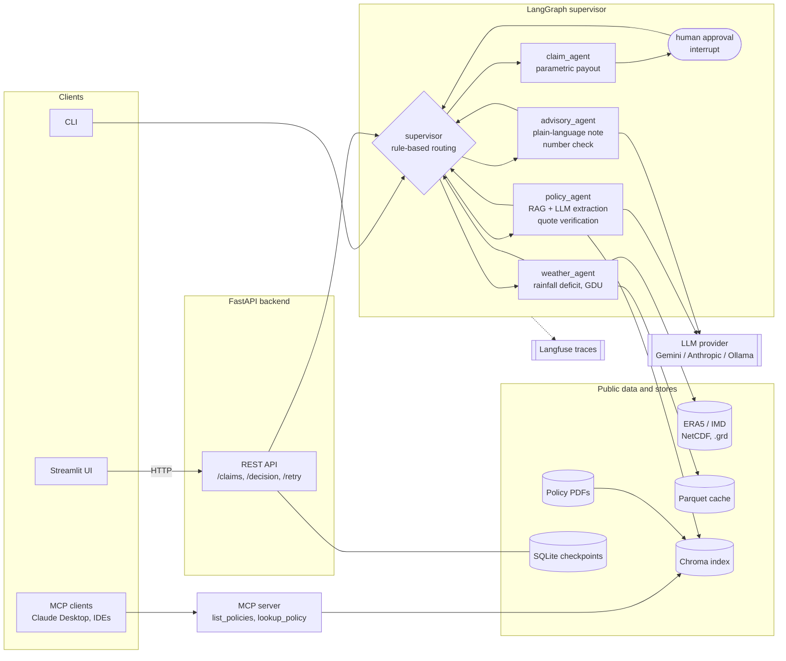

# crop-insurance-agent

Multi-agent crop insurance claims system (LangGraph supervisor) built only on public data.

Weather numbers and payouts are computed in code. The LLM only reads policy text and writes
the farmer's explanation, and both outputs are checked against source text or facts. A
human approves every claim.

## Architecture


> The architecture diagram and full docs come with the remaining agents.

## Setup

```bash
uv sync
cp .env.example .env   # then fill in keys
uv run pytest
```

## Weather data

Put weather files under `$DATA_DIR`:

- `era5/**/*.nc`: ERA5 / ERA5-Land, hourly or daily, with `tp` and `mx2t`/`mn2t` or `t2m`
- `imd/rain/Rainfall_ind{YYYY}_rfp25.grd`, `imd/tmax/Maxtemp_MaxT_{YYYY}.GRD`,
  `imd/tmin/Mintemp_MinT_{YYYY}.GRD`: IMD binary archives as downloaded, read with imdlib
  (`{YYYY}.grd` names also work)
- `imd/**/*.nc`: IMD NetCDF (e.g. from imdlib `to_netcdf`) with `rain`/`rf` and `tmax`/`tmin`

```bash
uv run crop-insurance-agent weather --lat 10.79 --lon 79.14 \
  --start 2023-06-01 --end 2023-09-30 --crop rice --source era5
```

## Policies

Each PDF in `$POLICIES_DIR` (default `policies/`) is one policy; its id is the file name
without `.pdf`. The two bundled PDFs are **illustrative samples** generated by
`scripts/make_sample_policies.py`, not real insurer documents. Add public PMFBY / RWBCIS
documents alongside them.

PDFs are chunked into a persistent Chroma index (`$CACHE_DIR/chroma`) using Chroma's local
all-MiniLM-L6-v2 embeddings (downloaded once, ~80 MB). The index re-syncs automatically
when PDFs change.

`policy_agent` asks the LLM only to extract trigger conditions, each with a verbatim quote.
Code then checks that each quote really appears in the retrieved text and compares the
thresholds with the weather numbers.

```bash
uv run crop-insurance-agent ingest-policies
uv run crop-insurance-agent policy --policy-id sample_rwbcis_paddy_thanjavur \
  --lat 10.79 --lon 79.14 --start 2023-06-01 --end 2023-09-30 --crop rice

# real-LLM extraction check on the sample PDFs (uses LLM_PROVIDER / LLM_MODEL)
RUN_LIVE_LLM=1 uv run pytest -m live
```

## Claims

`claim_agent` prices each met, verified trigger with the standard parametric rule:
payout % = max payout % × (observed − trigger) / (exit − trigger), clamped to 0..1.
A trigger with no exit pays its maximum. The total is capped at 100% of the sum insured,
and payout = total % × sum insured per hectare × area. No LLM is involved.

The node then pauses with a LangGraph `interrupt()` carrying the estimate. A reviewer
resumes the graph with:

```python
graph.invoke(Command(resume={"approved": True, "reviewer": "officer-1", "comment": "ok"}), config)
```

A cover with no cut-off pays its full maximum by default. This is listed under `assumptions`
in the estimate and in the approval prompt, so the reviewer can see it is not from the policy.
A rejected claim keeps its estimate for the audit trail and pays 0. A malformed decision
(e.g. no reviewer) is refused, and the graph stays paused.

## Advisory and the supervisor graph

`advisory_agent` builds a facts block from the other agents' outputs, and the LLM writes a
plain-English explanation from it. Every number in that text must match a fact (rounding
allowed). If any number doesn't match, a fixed template is used instead, and the output
records `generated_by: "template"`. English only for now; Tamil/Hindi are planned.

`graph/supervisor.py` routes with fixed rules: weather → policy → claim (pauses for
approval) → advisory. If the weather data is unusable or the policy id is unknown, the
error is recorded and sent straight to advisory, so the farmer still gets an explanation.
Such a run still ends with `status: "failed"`. The error is logged at ERROR level, the
Langfuse session gets the score `run_status=failed`, the CLI exits non-zero, and the API
lists the claim under `?status=failed`.

```bash
uv run crop-insurance-agent claim --policy-id sample_rwbcis_paddy_thanjavur \
  --lat 10.79 --lon 79.14 --start 2023-06-01 --end 2023-09-30 --crop rice \
  --area 2 --reviewer officer-1
```

## MCP policy-lookup server

`crop-insurance-mcp` serves the policy index over MCP. Its tools only retrieve text; they
never call an LLM, so the server needs no API key.

- `list_policies()`: ids of the indexed policy PDFs
- `lookup_policy(policy_id, query, k=4)`: verbatim excerpts with page numbers

```bash
uv run crop-insurance-mcp                                     # stdio
uv run crop-insurance-mcp --transport streamable-http --port 8001
```

Claude Desktop / IDE config:

```json
{
  "mcpServers": {
    "crop-insurance-policies": {
      "command": "uv",
      "args": ["--directory", "/path/to/crop-insurance-agent", "run", "crop-insurance-mcp"]
    }
  }
}
```

## HTTP API (FastAPI)

```bash
uv run crop-insurance-api                    # http://127.0.0.1:8000/docs
```

| Method | Path | Purpose |
| --- | --- | --- |
| `POST` | `/claims` | Run a claim until it pauses for approval (or ends early on an error) |
| `GET` | `/claims?status=` | List claims, optionally filtered by status |
| `GET` | `/claims/{id}` | Full state: weather, policy, pending review, decision, advisory |
| `POST` | `/claims/{id}/decision` | `{"approved", "reviewer", "comment"}` for a paused claim |
| `POST` | `/claims/{id}/retry` | Resume a stalled claim from its last checkpoint |
| `GET` | `/policies` | Indexed policy ids |

Claim statuses:

- `awaiting_approval`: paused for a reviewer.
- `completed`: finished normally.
- `failed`: an agent error was explained to the farmer, and the run is marked failed.
- `stalled`: an unexpected error stopped the run (e.g. an LLM outage). The request returns
  500 with a hint. Fix the cause, then call `/retry`; finished steps are not repeated and
  approval is not asked again.

Each claim is a LangGraph thread persisted in SQLite (`$CACHE_DIR/checkpoints.sqlite`), so
paused claims survive restarts. Loading a checkpoint only rebuilds this project's pydantic
schemas. Runs execute inside the request, and a per-claim lock stops two requests from
advancing the same claim at once.

## Streamlit UI

```bash
uv run crop-insurance-api                                   # in one terminal
uv run streamlit run src/crop_insurance_agent/ui/app.py     # in another
```

The UI only talks to the API (`API_URL`, default `http://127.0.0.1:8000`). It has three tabs:

- **Submit claim**
- **Review queue**: estimate, per-cover breakdown, and any default assumptions shown as
  warnings, with approve/reject that requires a reviewer name.
- **All claims**: filter by status; open a claim to see weather, policy conditions with
  their quotes and excerpts, the decision and the farmer's message; retry stalled claims.

## Docker Compose

```bash
docker compose up --build                       # API :8000, UI :8501, MCP :8001
docker compose --profile ollama up --build      # plus a local Ollama server
```

All services run from one image and bind to `127.0.0.1` only. Weather data is mounted
read-only from `DATA_HOST_DIR` (default `/mnt/g/datasets`, the external drive the local
`data` symlink points to; Docker does not follow a symlinked bind source). The folder must
exist, or `docker compose up` stops with an error instead of mounting an empty one.
Override with `DATA_HOST_DIR=/path docker compose up`. Claim state, the Parquet cache, the
Chroma indexes and the embedding model live in named volumes. The MCP server keeps its own
Chroma index, because two processes must not write the same Chroma directory. Secrets come
from `.env`.

## Tracing (Langfuse)

Tracing turns on when `LANGFUSE_PUBLIC_KEY` and `LANGFUSE_SECRET_KEY` are set
(`LANGFUSE_ENABLED=false` switches it off). Each graph run is traced through the Langfuse
LangChain callback: every agent node, retrieval and LLM call becomes a span. The claim id is
the session id, so a claim's first run and its post-approval resume appear as one session.
Traces contain prompts, policy excerpts, the farm location and payout amounts. Self-host
Langfuse or switch tracing off if that data must not leave your machine.

## Known limitations

- **CLI uses an in-memory checkpointer.** The `claim` CLI keeps state in memory for its
  single interactive session. The API persists claims in SQLite.
- **Synchronous runs.** `POST /claims` blocks while the weather, policy and LLM steps run.
  A background job queue would be the next step for slow providers.
- **Claim listing scans checkpoints.** `GET /claims` walks every checkpoint in SQLite. That
  is fine for a demo, but a real deployment needs a claims index table.
- **No authentication.** The API trusts whatever `reviewer` name the caller sends. That is
  fine on localhost, but real authentication and authorisation are required before the API
  is exposed beyond localhost.
- **Gemini default model.** `gemini-2.5-flash` is limited to accounts that used it before.
  Set `LLM_MODEL=gemini-flash-latest` (the stable alias). Pin a specific version such as
  `gemini-3.8-flash` if you need runs to stay reproducible. Free-tier keys get about 20
  requests per model per day, and each claim makes 2 LLM calls.
- **Sample policies only.** The bundled PDFs are illustrative, not real insurer documents.
- **Docker setup not yet run under Docker.** The image and Compose file were checked
  locally (frozen install, service commands with container settings) but not built.
- **`.env` line endings.** Use LF line endings. With CRLF, values carry a trailing `\r`,
  which some tools (including Docker Compose `env_file`) may not strip.
